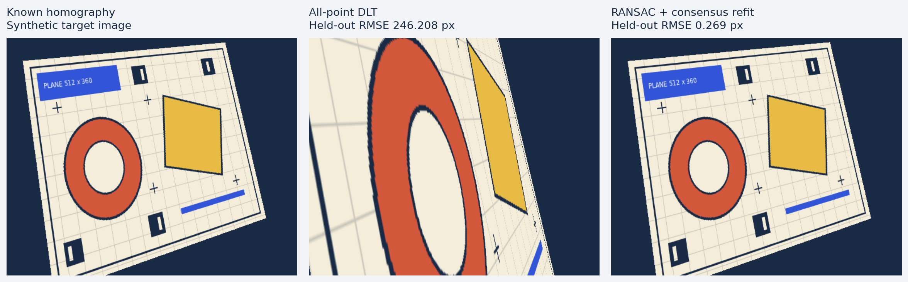

# Projective geometry lab

Normalized DLT homography estimation and bounded deterministic RANSAC, implemented using NumPy SVD as the numerical primitive. Four synthetic correspondence cases preserve input points, fitted matrices, consensus masks, sampled trials, training errors, held-out errors and repeated timing measurements.

[Technical report](docs/report.html) · [Comparison animation](docs/media/fit-comparison.mp4) · [Algorithms](docs/algorithms.md) · [Methodology](docs/methodology.md) · [Findings](docs/findings.md) · [Screenshots](docs/screenshots/README.md) · [Report recording](docs/recordings/README.md)



With 35% replaced target coordinates, the all-point DLT estimate has 246.208 px held-out RMSE; RANSAC with consensus refitting has 0.269 px. Both operate on the same noisy correspondences. The displayed images are warped from an owned procedural plane graphic using the saved matrices.

## Implementation

- Coordinate normalization to zero centroid and mean radius √2 before DLT.
- Correct full right-singular basis for the minimal 8 × 9 system.
- Rank, minimal-sample collinearity and normalized homography singularity checks.
- Scale normalization that supports valid transforms with `h33 = 0`.
- Near-infinite projections returned as invalid; transfer errors become infinite.
- Seeded four-point RANSAC with a hard trial cap, consensus refinement and an auditable trace.
- Inverse image mapping with explicit pixel-center support, bilinear interpolation and a bounded roundoff halo at borders.
- A JSON command-line estimator and 14 correctness/evidence tests, including captured-media integrity.

The project does not call an OpenCV homography estimator. It uses NumPy's SVD and linear-system operations for numerical linear algebra, with the estimation, scoring, sampling and resampling logic implemented here.

## Run

Python 3.11 or newer is required. The preserved run and CI use Python 3.13.

```sh
python -m pip install -e . -r requirements.txt
python -m unittest discover -s tests -v
python -m projectivelab results/published/inputs/outliers_35.json --method ransac
```

The CLI reads JSON arrays named `source` and `target`, each containing `[x, y]` points. Other fixture fields are ignored by the estimator. It prints a matrix, consensus indices and trial counts; `--output result.json` writes exclusively and refuses to overwrite an existing file. `--threshold`, `--seed` and `--max-trials` configure RANSAC. `--method dlt` fits all points directly.

## Reproduce evidence

```sh
python scripts/run_study.py --out outputs/my-run
```

The destination must be empty. The committed run in `results/published/` stays intact. To reconcile a fresh run:

```sh
# POSIX shell
PROJECTIVE_RESULTS=outputs/my-run python -m unittest discover -s tests -v
```

```powershell
# PowerShell
$env:PROJECTIVE_RESULTS = 'outputs/my-run'
python -m unittest discover -s tests -v
Remove-Item Env:PROJECTIVE_RESULTS
```

Rebuild visual evidence from the preserved models:

```sh
python scripts/build_visuals.py
python scripts/render_comparison.py
python scripts/build_report.py
```

The optional animation renderer needs ffmpeg with libx264 on `PATH`. The committed eight-second MP4 crossfades each fixed fitted warp against the known target. It is an alignment comparison, separate from the recorded RANSAC iteration trace. Nothing autoplays. Open `docs/report.html` or serve the repository with `python -m http.server 8080`.

## Preserved results

| Case | Training points | All-point held-out RMSE, px | RANSAC held-out RMSE, px | RANSAC trials |
| --- | ---: | ---: | ---: | ---: |
| Exact | 80 | 1.41 × 10⁻¹³ | 1.03 × 10⁻¹³ | 20 |
| Target noise only | 100 | 0.235 | 0.210 | 20 |
| 35% outliers | 120 | 246.208 | 0.269 | 30 |
| 60% outliers | 160 | 2465.869 | 0.298 | 217 |

Each model is evaluated on the same separate 165-point clean source grid. Corruption labels and held-out targets are used only for evaluation. These four cases share one known planar transform; they are not a broad real-image benchmark or an estimate of general RANSAC success probability.

## Evidence layout

```text
src/projectivelab/       estimation, projection, resampling, generators and CLI
tests/                  analytic, independent review and evidence checks
results/published/inputs/ complete synthetic cases and flattened point CSVs
results/published/models/ fitted matrices and returned consensus masks
results/published/errors/ training and held-out per-point errors
results/published/traces/ sampled subsets, consensus changes and best matrices
docs/images/            procedural source, warped images, support masks and hashes
docs/figures/           comparisons, error distributions and measured runtime
docs/media/             alignment replay and provenance
outputs/                ignored fresh runs
```

This AI-assisted study uses entirely synthetic planar data and owned procedural imagery. Correspondences are supplied rather than detected from the images. It does not demonstrate feature matching, camera calibration, lens-distortion correction, nonplanar reconstruction or deployment on real scenes. The RANSAC confidence parameter describes a conditional sampling assumption, not a guarantee of a correct model.
